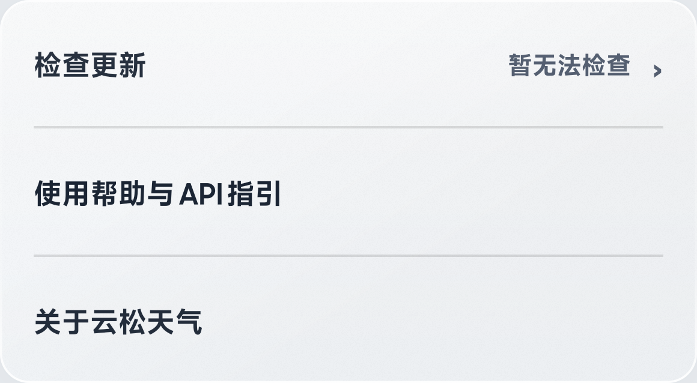
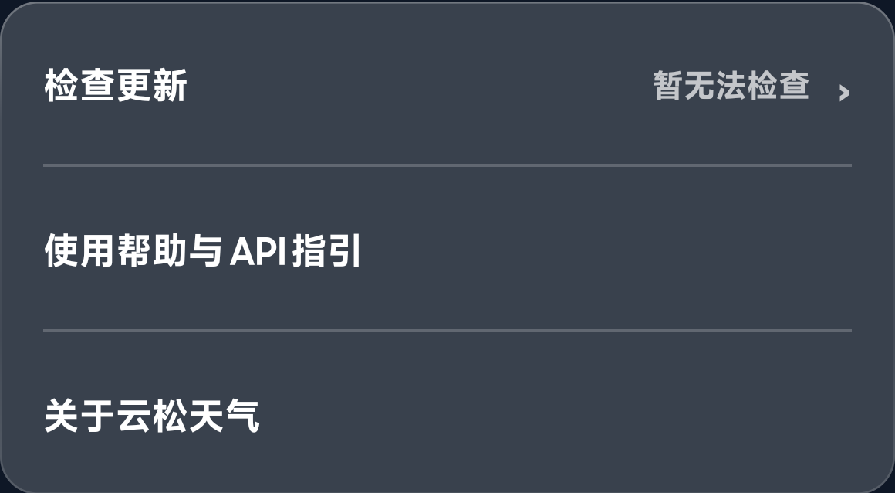

# 云松天气

面向 Android 的原生天气应用，使用 Kotlin、XML 和自定义 View 构建。
本仓库仅包含用户自行配置天气 API 的版本，不提供内置天气密钥或个人服务账户。
公开工程**不包含原第三方天气/生活建议 SVG**，也不通过 Base64、加密包或 Git 历史隐藏携带这些文件。
缺少私有素材时，源码使用独立绘制的简化图标，天气数据和功能不受影响。

当前版本：**1.1**。维护者：**SIAKNG**。
应用显示名称统一为“云松天气”；版本标识 `1.1-userapi` 用于区分构建，包名仍为 `com.example.weatherapp.userapi`。
当前维护构建号：`4`。

> 当前处于**私有审阅阶段**。仓库、源码和安装包仅供获授权账号检查；未经维护者再次确认，不转为公开。

## 下载与更新

[查看安装包下载页](https://github.com/SIAKNG/yunsong-weather/releases/latest) · [全部版本](https://github.com/SIAKNG/yunsong-weather/releases)

在应用“天气设置”底部，同一张毛玻璃卡片提供“检查更新”“使用帮助与 API 指引”“关于云松天气”。
点击“检查更新”直接打开 GitHub 安装包下载页；发现较新正式 APK 时，行尾会提示“有新版本”。
应用不下载或自动安装 APK，不索取 GitHub 密码、Token 或账号权限。

- 成功检查缓存六小时；检查失败后十分钟再尝试，避免频繁请求。
- 仓库私有、没有可用正式 APK、网络受限或 GitHub 限流时，不会误报“已是最新版本”。
- 私有审阅阶段，应用匿名查询无法读取版本信息，显示“暂无法检查”；网页下载需要有权限的账号登录。
  未来仓库经确认公开后，同一检查入口即可读取公开正式版本。
- 发布使用专用正式签名。旧调试签名测试版无法直接覆盖，请先妥善记录自己的配置；不要随意卸载。

界面与版本规则说明见 [docs/UPDATES.md](docs/UPDATES.md)。

## 功能

- 城市管理、定位天气、动态天气背景与毛玻璃卡片。
- 实况、48 小时及多日预报，以及温度、体感、风力、气压、能见度、湿度、紫外线和空气质量详情。
- 分钟降雨趋势、日出日落、生活建议和本机天气提醒。
- 深色/浅色模式、首次使用引导、API 获取教程与接口支持情况检测。
- 本地缓存、配置加密存储、按所选天气源和实际权限显示可用数据。
- GitHub 安装包下载入口与新版本提示，和使用帮助、关于页集中显示。

功能是否有数据、可用时长和更新频率取决于你填写的 API、套餐、地区及供应商响应；不承诺所有 API 均覆盖以上项目。
通知使用 Android 本机调度，可能受系统后台限制影响，并非服务端实时推送。

### 页面与操作

| 页面 | 可以做什么 |
| --- | --- |
| 天气首页 | 查看当前天气与卡片，左右切换已保存城市，下拉刷新 |
| 城市管理 | 点顶部地址进入，添加、切换或管理城市 |
| 预报详情 | 点 48 小时或多日卡片，横滑选择时刻，查看各项趋势与摘要 |
| 指标详情 | 查看空气质量、紫外线、体感、风、气压、能见度、湿度和日出日落 |
| 生活建议 | 查看穿衣、出行等建议；实际项目依赖接口覆盖 |
| 天气设置 | 配置天气源、主题、单位和本机提醒，查看帮助、版本与下载入口 |

### 设置页实机效果

以下仅截取新合并卡片，不含地址、坐标或 API。私有仓库期间“暂无法检查”为预期状态。

| 浅色 | 深色 |
| --- | --- |
|  |  |

## 安装和第一次使用

1. 从本仓库的 Releases 下载正式发布的 APK，允许系统安装该文件。
2. 完成引导，在“设置 → 天气源/API 配置”填写自己的接口信息。
3. 彩云天气填写 Token；和风天气填写控制台分配的 API Host 和 API Key。
4. 点击“检测 API 支持情况”检查能力，确认后保存并使用。
5. 点击首页地址管理城市，点击天气卡片查看更多详情。定位和通知权限可按需开启。

申请入口：[彩云开放平台](https://platform.caiyunapp.com/)、[和风开发平台](https://dev.qweather.com/)。
申请流程和要求以供应商当前页面为准。不要在 Issue、截图、代码或聊天中公开真实 API Key。

## 本地构建

建议使用支持此工程的 Android Studio，安装 Android SDK 37、JDK 25，使用随项目提供的 Gradle Wrapper 9.5.0。
工程使用 Android Gradle Plugin 9.3.1，其内置 Kotlin 支持无需额外声明 Kotlin 插件。
命令行安装 SDK 时，Google 软件包名称是 `platforms;android-37.0`，不是 `platforms;android-37`。

1. 克隆仓库并在 Android Studio 打开。
2. 让 Android Studio 自动生成本机 `local.properties` 和 SDK 路径；该文件不可提交。
3. Windows 执行下列命令；macOS/Linux 将 `gradlew.bat` 换为 `./gradlew`。

```powershell
.\gradlew.bat :app:testUserApiDebugUnitTest
.\gradlew.bat :app:assembleUserApiDebug
.\gradlew.bat :app:assembleUserApiRelease
```

Debug 用于开发；Release 默认生成**未签名 APK**，正式分发前须使用自己保管的发布密钥签名。
仓库不提供或保存任何签名私钥。自行构建包的签名可能与已安装版本不同，不能因此直接覆盖升级。
不要为了安装测试包贸然卸载已有版本，以免丢失配置和城市数据。

### 可选的本机素材

维护者的个人构建可使用仓库外、已取得相应许可的图标目录：

```powershell
.\gradlew.bat :app:assembleUserApiRelease -PprivateIconAssetsDir="D:/private-assets/weather-app"
```

目录结构与注意事项见 [docs/PRIVATE_ARTWORK.md](docs/PRIVATE_ARTWORK.md)。没有此参数也可以正常构建。
包含原素材的 APK 仍可能被提取或截屏，不能保证“不可逆向”；仅排除公开源码并不扩大图标使用/分发许可。

## 数据和隐私

- 查询天气时，坐标、IP 及认证信息会按功能发送给对应服务；部分缺失字段可能使用补充数据源。
- 相关服务包含彩云天气、和风天气、Open-Meteo、空气质量公开数据及城市检索服务，具体使用情况以代码和应用内说明为准。
- 用户配置在设备端通过 Android Keystore/AES-GCM 存储；本地缓存用于加速显示。
- 自填版本禁用应用备份，不包含维护者的内置 API、个人联系方式、本机测试截图或设备记录。
- 不要把带有地址、坐标或真实凭证的日志和截图提交为问题反馈。

## 许可证与素材

维护者有权授权的项目代码按 **GPL-3.0-only** 提供，见 [LICENSE](LICENSE)。
第三方代码、图标及商标保留原权利人的权利和适用条款；不因本仓库声明 GPL 而自动重新授权。
素材来源和依赖说明见 [THIRD_PARTY_NOTICES.md](THIRD_PARTY_NOTICES.md)。
天气图标来源为 iconfont 用户“桑榆菲碗”的[天气图标集](https://www.iconfont.cn/collections/detail?cid=53861)。
维护者说明其限免费非商用使用；当前仍待确认原 SVG 公开再分发权限，图标不按项目 GPL 重新授权。
因此本仓库不分发该批原 SVG；发布 APK 若包含第三方素材，素材仍按原作者的独立许可处理。

## 反馈

请描述应用版本、Android 版本、复现步骤、预期和实际表现，并先删除个人地址及凭证。
安全问题请先按 [SECURITY.md](SECURITY.md) 处理，不要公开有效密钥。
